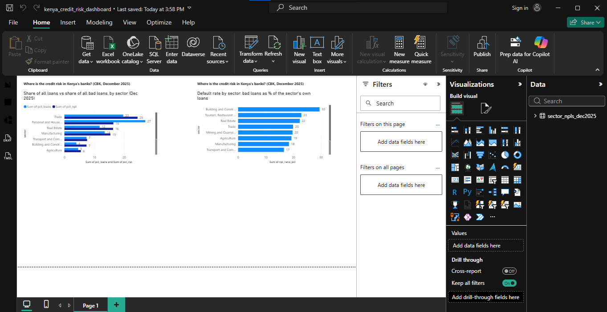

# Where is the credit risk in Kenya's banks?

An analysis of non-performing loans (NPLs) by economic sector, using the Central Bank of Kenya's *Bank Supervision Annual Report 2025* (December 2025 data), with a Power BI dashboard.

## Key findings

- Banks held Ksh 4,347 billion in gross loans, of which Ksh 697 billion (**16.0%**) were non-performing.
- **The biggest sector is not the riskiest.** Personal and Household is the largest sector at 27.1% of loans, but only 9.7% of its loans are non-performing, which is among the lowest rates.
- **Building and Construction has the highest default rate at 29.5%**, nearly double the industry average, from only 4.0% of total loans.
- **Trade holds the most bad loans** (Ksh 170.6 billion, 24.5% of all NPLs) and has a default rate of 19.9%.
- Real Estate (22.3%) and Tourism, Restaurants and Hotels (22.9%) also run well above average. Financial Services (3.3%) and Energy and Water (6.8%) are the safest.
- Personal and Household, Trade, Manufacturing and Real Estate together hold 72.1% of loans and 72.6% of NPLs.

## Method

1. Extracted Table 18 (sectoral distribution of loans and NPLs) from the CBK report PDF using `pdfplumber`, including sector names that wrap across lines.
2. Checked that the 11 sectors add up to the published totals.
3. Calculated each sector's default rate: `gross NPLs / gross loans x 100`.
4. Built a two-chart Power BI dashboard: share of loans vs share of bad loans, and default rate by sector.

## Limitations

- This is one snapshot (December 2025), so it shows where the risk sits, not how it changed over time.
- Figures are aggregated across all banks. Provisions and collateral are not considered, so a high NPL ratio does not mean the same loss for every sector.
- The analysis shows where the bad loans are, not why. The CBK report attributes them mainly to a challenging business environment.

## Files

- `kenya_credit_risk_analysis.ipynb`: extraction and analysis
- `kenya_credit_risk_dashboard.pbix`: Power BI dashboard (needs Power BI Desktop)
- `kenya_credit_risk_dashboard.pdf`: dashboard export
- `data/`: source report and cleaned dataset

*Author: Antonette Kuvuna*
